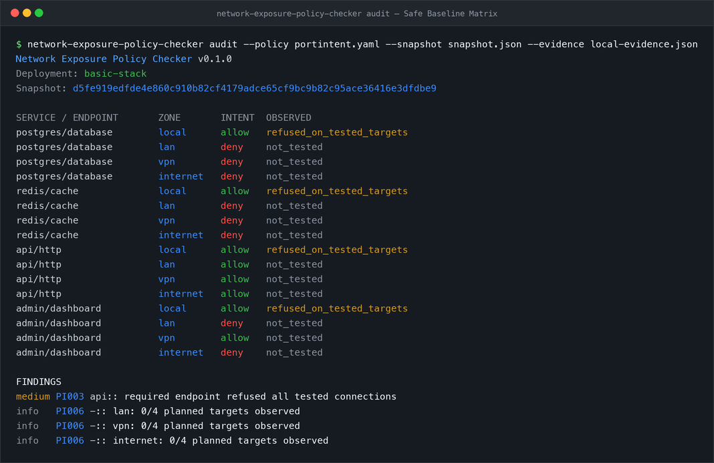
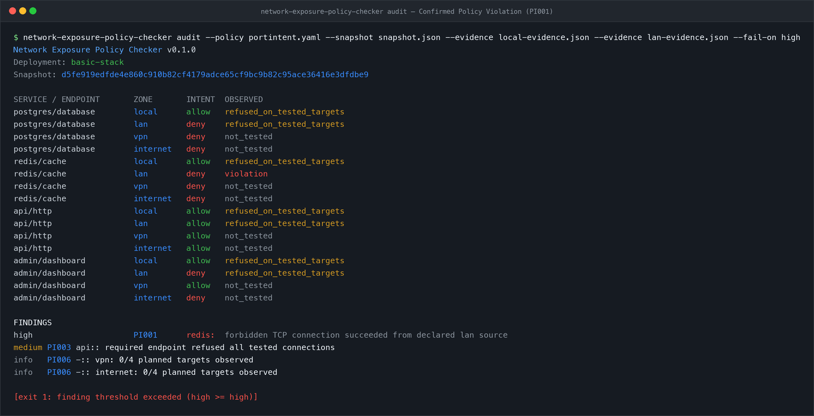
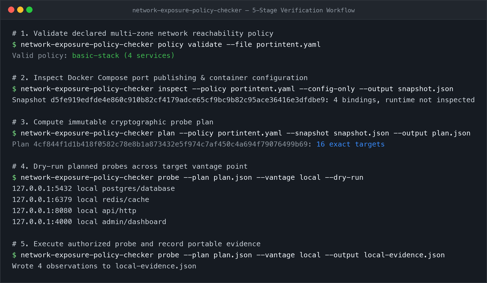
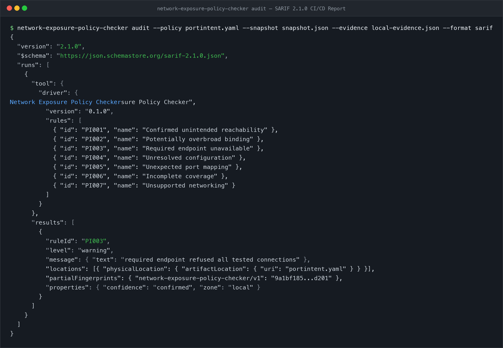

# Network Exposure Policy Checker

Declare intended network reachability. Detect unintended exposure.

[](docs/screenshots/overview.png)

**Network Exposure Policy Checker** is a high-assurance Rust CLI for verifying Docker Compose deployments against declared multi-zone network exposure policies. It bridges the gap between static container configuration (ports published to `0.0.0.0`) and physical network reachability by combining Docker inspection with operator-collected TCP connection evidence.

Most importantly, it keeps **inferred configuration warnings** distinct from **confirmed reachability violations**, preventing false alarms while ensuring actual perimeter breaches are immediately surfaced.

---

## Why

An open or broadly bound port does not prove that an external client can connect, nor does an internal binding guarantee isolation across complex VPCs, Docker Desktop proxies, or host networks:

- **Broad bindings (`0.0.0.0`)** suggest possible exposure, but corporate firewalls, security groups, or router ACLs may block traffic.
- **Localhost bindings (`127.0.0.1`)** protect against external traffic, but misconfigured reverse proxies or host networking might expose them.
- **Declared Intent vs. Ground Truth**: Teams declare which zones (_Local_, _LAN_, _VPN_, _Internet_) should reach each service. Network Exposure Policy Checker produces cryptographic probe plans and verifies imported evidence against the policy matrix:

| Service    | Local | LAN   | VPN   | Internet | Enforcement Mode |
| ---------- | ----- | ----- | ----- | -------- | ---------------- |
| PostgreSQL | allow | deny  | deny  | deny     | Strict Isolation |
| Redis      | allow | deny  | deny  | deny     | Strict Isolation |
| API        | allow | allow | allow | allow    | Public Ingress   |
| Admin      | allow | deny  | allow | deny     | Internal Only    |

---

## Visual Demonstration

### Confirmed Policy Violation (`PI001`)

When probe evidence collected from an unauthorized vantage point (such as the LAN or Internet) successfully completes a TCP handshake to a denied service, `audit` generates a confirmed finding and exits with code `1` when `--fail-on` is set:

[](docs/screenshots/audit-violation.png)

### 5-Stage Verification Pipeline

The verification workflow consists of five distinct, composable phases designed for zero-trust deployment environments:

[](docs/screenshots/workflow-pipeline.png)

### CI/CD & SARIF Integration

Generate machine-readable SARIF v2.1.0 reports for native integration with GitHub Code Scanning, GitLab Security Dashboards, and compliance tracking:

[](docs/screenshots/sarif-integration.png)

---

## Key Features

- **Multi-Zone Policy Declarations**: Define reachability per endpoint across `local`, `lan`, `vpn`, and `internet` zones.
- **Dual-Phase Evidence Engine**: Separates Docker static configuration parsing (`inspect --config-only`) from empirical TCP connection attempts (`probe`).
- **Cryptographic Plan Integrity**: Probe plans include SHA-256 digests over target matrices to prevent tampering and detect out-of-sync execution.
- **Confidence Tiers**: Distinguishes between `confirmed` (empirical TCP handshake), `inferred` (broad 0.0.0.0 binding without probe evidence), and `inconclusive` states.
- **Fail-Safe CI/CD Controls**: `--fail-on <severity>` for automated build gates; `--require-vantage <zones>` to guarantee zero blind spots.
- **Standardized Outputs**: Human-readable terminal matrix, structured JSON, and SARIF v2.1.0.

---

## Installation

### Prerequisites

- Stable Rust toolchain (1.75+ or newer).
- (Optional) Docker Compose v2 for `init` and live `inspect`.

### Build from Source

```sh
cargo install --path .
```

Or build the release binary locally:

```sh
cargo build --release
./target/release/network-exposure-policy-checker --help
```

---

## Quick Start

A ready-to-run demonstration stack is provided in [examples/basic-stack](examples/basic-stack/README.md).

```sh
# 1. Validate your declared reachability policy
network-exposure-policy-checker policy validate --file examples/basic-stack/portintent.yaml

# 2. Inspect Docker Compose configuration (works offline without Docker daemon)
network-exposure-policy-checker inspect --policy examples/basic-stack/portintent.yaml --config-only --output snapshot.json

# 3. Generate the cryptographic probe plan
network-exposure-policy-checker plan --policy examples/basic-stack/portintent.yaml --snapshot snapshot.json --output plan.json

# 4. Preview planned probe targets for the local vantage point
network-exposure-policy-checker probe --plan plan.json --vantage local --dry-run

# 5. Collect local TCP probe evidence
network-exposure-policy-checker probe --plan plan.json --vantage local --output local-evidence.json

# 6. Audit policy vs. configuration vs. empirical evidence
network-exposure-policy-checker audit \
  --policy examples/basic-stack/portintent.yaml \
  --snapshot snapshot.json \
  --evidence local-evidence.json
```

---

## Multi-Vantage Operational Workflow

To test network boundaries across isolated network segments (LAN, VPN, Internet):

1. **Generate the plan** on the deployment machine or CI runner.
2. **Distribute the plan** and the `network-exposure-policy-checker` binary to authorized probe hosts in target zones.
3. **Execute probe on each remote host**:

   ```sh
   # On LAN probe host:
   network-exposure-policy-checker probe --plan plan.json --vantage lan --source-id lan-host-01 --output lan-evidence.json

   # On external Internet probe host:
   network-exposure-policy-checker probe --plan plan.json --vantage internet --source-id cloud-worker-01 --output internet-evidence.json
   ```

4. **Aggregate evidence** into the final audit:
   ```sh
   network-exposure-policy-checker audit \
     --policy portintent.yaml \
     --snapshot snapshot.json \
     --evidence local-evidence.json \
     --evidence lan-evidence.json \
     --evidence internet-evidence.json \
     --require-vantage local,lan,internet \
     --fail-on high
   ```

---

## CLI Reference

| Command                                                                               | Description                                                    |
| ------------------------------------------------------------------------------------- | -------------------------------------------------------------- |
| `policy validate --file <PATH>`                                                       | Validates syntax and host definitions in a policy file.        |
| `init --compose <COMPOSE> --output <OUT>`                                             | Scaffolds a draft policy from an existing `compose.yaml`.      |
| `inspect --policy <POLICY> --output <OUT> [--config-only]`                            | Inspects Compose ports and runtime Docker bindings.            |
| `plan --policy <POLICY> --snapshot <SNAP> --output <OUT>`                             | Calculates the exact probe targets and plan hash.              |
| `probe --plan <PLAN> --vantage <ZONE> [--dry-run] [--output <OUT>]`                   | Executes non-destructive TCP connect checks.                   |
| `audit --policy <P> --snapshot <S> [--evidence <E>...] [--format human\|json\|sarif]` | Generates the audit report and evaluates policy findings.      |
| `explain <RULE>`                                                                      | Displays the formal explanation and remediation for a rule ID. |
| `doctor`                                                                              | Checks availability of the local Docker Compose runtime.       |

### Exit Codes

| Code | Meaning                          | Cause                                                                           |
| :--: | -------------------------------- | ------------------------------------------------------------------------------- |
| `0`  | Success                          | Policy satisfied; all findings below threshold; all required vantages observed. |
| `1`  | Finding Threshold Exceeded       | Findings encountered at or above the level specified in `--fail-on`.            |
| `2`  | Invalid Policy or Options        | Syntax error, unresolvable target address, or invalid arguments.                |
| `3`  | Docker Daemon Failure            | Docker Compose or container inspection failed.                                  |
| `4`  | Invalid or Incompatible Evidence | Evidence plan ID mismatch, tampered targets, or stale observations.             |
| `5`  | Required Vantage Missing         | A zone specified in `--require-vantage` had unverified planned targets.         |
| `6`  | I/O or Internal Error            | File not found, permission denied, or disk error.                               |

---

## Rule Catalog

| Rule    |    Severity     |        Confidence        | Description                                                            |
| ------- | :-------------: | :----------------------: | ---------------------------------------------------------------------- |
| `PI001` | High / Critical |        Confirmed         | Forbidden TCP connection succeeded from declared zone.                 |
| `PI002` |     Medium      |         Inferred         | Broad Docker binding (`0.0.0.0` or `::`) may expose a denied endpoint. |
| `PI003` |     Medium      |        Confirmed         | Required endpoint refused tested connections from a mandatory zone.    |
| `PI004` |  Medium / Info  | Confirmed / Inconclusive | Referenced Compose service is missing or container has not started.    |
| `PI005` |     Medium      |        Confirmed         | Published host port differs from declared policy expectation.          |
| `PI006` |      Info       |       Inconclusive       | Required probe coverage is missing or incomplete for a planned zone.   |
| `PI007` |      Info       |       Inconclusive       | Unsupported networking mode (e.g. `host` network) or protocol (`udp`). |

Run `network-exposure-policy-checker explain <RULE_ID>` for inline remediation guidance.

---

## Policy Specification

See [examples/basic-stack/portintent.yaml](examples/basic-stack/portintent.yaml) for a complete reference.

```yaml
version: 1
project:
  name: basic-stack
  compose_files: [compose.yaml]

targets:
  local:
    addresses: [127.0.0.1]
  lan:
    addresses: [192.0.2.10]
  vpn:
    addresses: [198.51.100.10]
  internet:
    addresses: [example.invalid]

services:
  - name: postgres
    compose_service: postgres
    sensitivity: high
    endpoints:
      - name: database
        container_port: 5432
        host_port: 5432
        protocol: tcp
        access:
          local: allow
          lan: deny
          vpn: deny
          internet: deny

  - name: api
    compose_service: api
    sensitivity: normal
    endpoints:
      - name: http
        container_port: 80
        host_port: 8080
        protocol: tcp
        access:
          local: allow
          lan: allow
          vpn: allow
          internet: allow
        require_reachable_from: [local]
```

- **`sensitivity`**: When set to `high`, unintended reachability from `internet` escalates finding `PI001` to `critical`.
- **`require_reachable_from`**: Asserts mandatory reachability; connection refusal from specified zones triggers `PI003`.
- **`host_port: auto`**: Supported for dynamically assigned ephemeral host ports resolved at container runtime.

---

## CI/CD Pipeline Integration

Refer to [examples/ci/README.md](examples/ci/README.md) for a complete GitHub Actions workflow.

```yaml
- name: Audit Network Intent
  run: |
    network-exposure-policy-checker audit \
      --policy portintent.yaml \
      --snapshot snapshot.json \
      --format sarif \
      --output audit.sarif \
      --fail-on high

- name: Upload SARIF to GitHub Code Scanning
  uses: github/codeql-action/upload-sarif@v3
  if: always()
  with:
    sarif_file: audit.sarif
```

---

## Development & Testing

```sh
# Format verification
cargo fmt --all --check

# Linter checks with strict warning enforcement
cargo clippy --all-targets --all-features -- -D warnings

# Execute test suite
cargo test --all-features

# Build release binaries
cargo build --release
```

### Documentation & Reference Guides

- [Architecture Overview](docs/architecture.md): Internal data flows and schema versioning.
- [Threat Model](docs/threat-model.md): Trust boundaries, vantage assumptions, and attacker model.
- [Probe Model](docs/probe-model.md): Non-destructive TCP probe methodology and safety guarantees.
- [Docker Behavior](docs/docker-behavior.md): How Docker NAT, port publishing, and desktop routing impact exposure.
- [Limitations](docs/limitations.md): Boundary edge cases, UDP handling, and cloud firewalls.
- [CI/CD Integration Guide](docs/ci-integration.md): Best practices for automated pull request evaluation.

---

## Contributing & Security

- [CONTRIBUTING.md](CONTRIBUTING.md) — Guidelines for code style, issue reporting, and pull requests.
- [SECURITY.md](SECURITY.md) — Vulnerability disclosure process.

---

## License

Network Exposure Policy Checker is licensed under the [MIT License](LICENSE).
